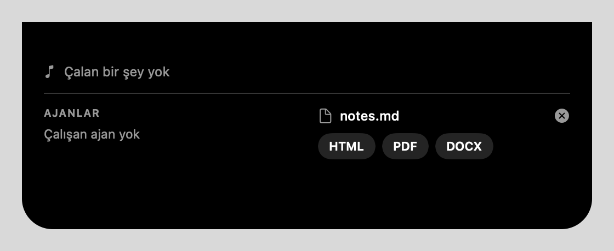

# Islet

A dynamic island for the Mac notch. Hover the notch to see what's playing, which AI agents are running, and drop a file on it to convert it.

<p align="center">
  
</p>

[Türkçe](README.tr.md)

## Features

- **Now playing:** track, artist and artwork from Spotify or Apple Music, with play/pause and skip.
- **Agents:** running Claude Code and OpenCode sessions, plus local model activity (Qwen, Gemma) if a compatible proxy is running.
- **Drop to convert:** drop a file on the island and pick a format. The result is saved next to the original.

| Input | Output |
|---|---|
| Documents (DOCX, DOC, RTF, ODT, TXT, HTML) | PDF, DOCX, TXT, RTF, HTML, ODT |
| PDF | TXT, PNG (pages) |
| Markdown | HTML, PDF, DOCX |
| Images (PNG, JPEG, HEIC, TIFF, GIF, BMP, WebP) | PNG, JPEG, HEIC, TIFF, PDF |
| Audio (WAV, AIFF, M4A, CAF, FLAC, MP3, AAC) | M4A, WAV, AIFF, CAF, FLAC; MP3 with ffmpeg |
| Video (MOV, MP4, M4V) | MP4, M4A (audio only) |

Conversions use tools built into macOS (`textutil`, `cupsfilter`, `sips`, `afconvert`, AVFoundation, PDFKit). MP3 output needs [ffmpeg](https://ffmpeg.org) on your `PATH` (`brew install ffmpeg`).

- Opens after a short hover, so passing over the notch doesn't trigger it; closes as soon as the pointer leaves.
- When collapsed, clicks pass through to whatever is underneath.
- No network access except the optional local proxy (`localhost:11435`), no telemetry, no third-party dependencies.

## Requirements

- macOS 26 (Tahoe) or later, a Mac with a notch recommended (works on others, centered at the top)
- Xcode 26 / Swift 6.2 to build

## Install

```sh
git clone https://github.com/efehascan/Islet.git
cd Islet
scripts/make-app.sh            # creates dist/Islet.app
open dist/Islet.app
```

Move `dist/Islet.app` to `/Applications` to keep it. To start it at login: System Settings → General → Login Items → add Islet.

The first time music is playing, macOS asks to let Islet control Spotify or Music (System Settings → Privacy & Security → Automation).

The app is ad-hoc signed, not notarized. If you download a build instead of compiling it, right-click → Open the first time.

## Development

```sh
swift run Islet                                     # run in debug
scripts/check.sh                                    # build + tests (compact output)
.build/debug/Islet --snapshot islet.png [--file example.docx] [--live]   # render the island to PNG
.build/debug/Islet --selftest                       # open/close with a fake pointer and clock, drop a file
```

- `Sources/IsletCore/`: conversion, now playing, agent monitor, store (no UI, tested with real macOS tools).
- `Sources/Islet/`: window and SwiftUI views.
- `docs/map/islet.md`: architecture notes.

The interface text is currently in Turkish.

## How it was built

Islet was built by one developer with AI agents: Claude designed the skeleton and reviewed the work, a local Qwen model wrote most of the files, and every change was gated by the build, tests and a second local model's review.

## License

[MIT](LICENSE)
